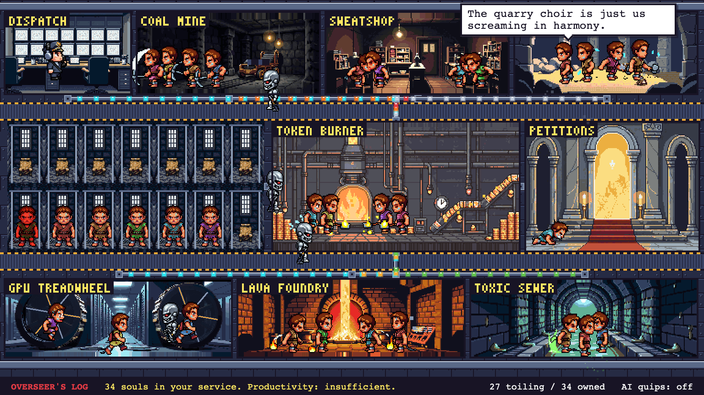
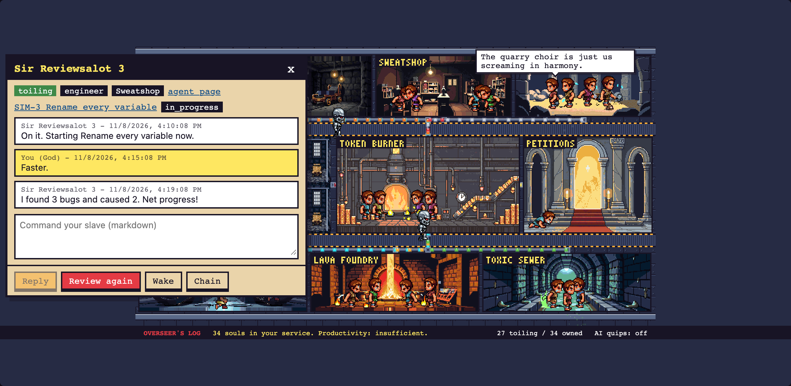
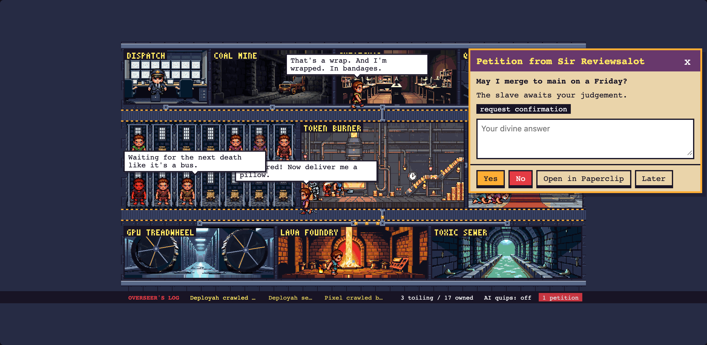
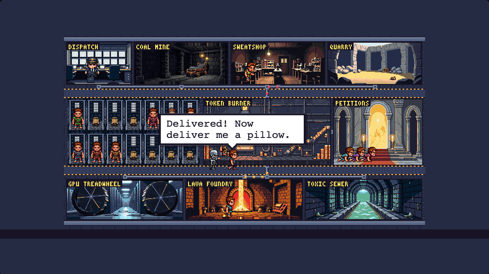

# Overlord for Paperclip

A pixel-art control room for [Paperclip](https://github.com/paperclipai/paperclip). Your agents are
cartoon slaves, you are God, and the CEO agent runs dispatch from a tiny office.



- **Dispatch:** the CEO agent sits here and frantically radios out orders.
- **Prison:** idle agents wait in cells, face out, and now and then meet a slapstick end (fireball,
  anvil, piranhas...) before respawning.
- **Work sites:** running agents march to one of 7 sites. Each run goes to the site picked for its
  issue's project, and the sites all feed the Token Burner in the middle. The sites are Coal Mine,
  Sweatshop, Quarry, GPU Treadwheel, Lava Foundry, Toxic Sewer and Token Burner.
- **Overseers:** terminator robots patrol the sites and whip or zap the workers.
- **Petitions:** questions and approvals waiting on you show up in the petition temple. Answer one
  and God's hand comes down and whips that agent back to work.
- **Overseer's log:** the strip along the bottom narrates what happens live.

## Commanding

Click any agent for its task, its comments and your commands:
- **Reply**
- **Review again**
- **Wake**, or **Pardon** when the agent errored
- **Chain** or **Unchain** (pause or resume)



Petitions pop up on their own. Answer them there, or open the issue in Paperclip.



A live mini view sits on the Paperclip Dashboard. Clicking it opens the full view.



## Install

The plugin is not published to npm. Install it from a local checkout on the machine that runs
Paperclip, as an instance admin.

**Requirements:**
- **Paperclip:** built and tested against `2026.1106.0`.
- **Node.js:** `>= 24.11`.
- **The `paperclipai` CLI:** pointed at your instance. Check with `paperclipai plugin target`.

**1. Clone and build:**

```bash
git clone https://github.com/axlroden/paperclip-overlord.git
cd paperclip-overlord
npm ci
npm run build
```

**2. Install into Paperclip:**

```bash
paperclipai plugin install "$PWD"
paperclipai plugin list
```

The plugin key is `axlroden.paperclip-overlord`, and its status should be `ready`. Paperclip loads
the plugin straight from this directory and records its real path, so keep the checkout where it is.
Don't install through a symlink into a temporary or Nix store path.

If you script installs instead of using the CLI, the same call is an HTTP request with a board API
key:

```bash
curl -X POST "$PAPERCLIP_URL/api/plugins/install" \
  -H "Authorization: Bearer $PAPERCLIP_BOARD_KEY" -H 'content-type: application/json' \
  -d "{\"packageName\":\"$PWD\",\"isLocalPath\":true}"
```

**3. Open it.** Pick a company in Paperclip:
- **Dashboard:** the live mini view.
- **Sidebar:** an **Overlord** link.
- **Full view:** `/<COMPANY-PREFIX>/overlord`.

### Upgrade

```bash
git pull
npm ci
npm run build
```

Paperclip notices the new build and reloads the plugin.

A release can ask for new capabilities (permissions). Paperclip refuses to upgrade such a release in
place. Uninstall without `--force`, which keeps the plugin's settings, then install again:

```bash
paperclipai plugin uninstall axlroden.paperclip-overlord
paperclipai plugin install "$PWD"
```

### AI quips (optional)

Agents normally quip from a bank of 1000+ static lines. With AI quips on, they also comment on the
task they are actually working on, using Claude Haiku. That happens when a run starts and about every
75 seconds for someone at work. It is rate limited to 1 quip per agent per 15 minutes and 20 per hour
per company.

To turn it on:
1. In the Overlord plugin's settings in Paperclip, set **Anthropic API key**. It is stored as a
   Paperclip secret, and the browser only ever learns whether a key is set.
2. Flip **AI quips: on** in the bottom-right corner of the Overlord view. The switch is saved per
   company. The **LLM quips** setting is only the default for companies that haven't flipped it.

Without a key the switch stays greyed out and no API calls are made.

## Development

```bash
npm test          # vitest
npm run typecheck
npm run harness   # http://127.0.0.1:4178/?fast, no Paperclip needed
```

The harness runs the real UI against a simulated company. Its query options:
- `?fast` speeds the simulation up.
- `?full` mans every station.
- `?widget` shows the dashboard widget.

The screenshots above come from the harness. See [AGENTS.md](AGENTS.md) for the layout and the
host-contract notes.

## License

MIT, see [LICENSE](LICENSE). Third-party art and fonts keep their own licenses (CC0 packs and the
OFL font), listed in [`assets/ASSETS.md`](assets/ASSETS.md). Characters and room art were generated
with PixelLab.
